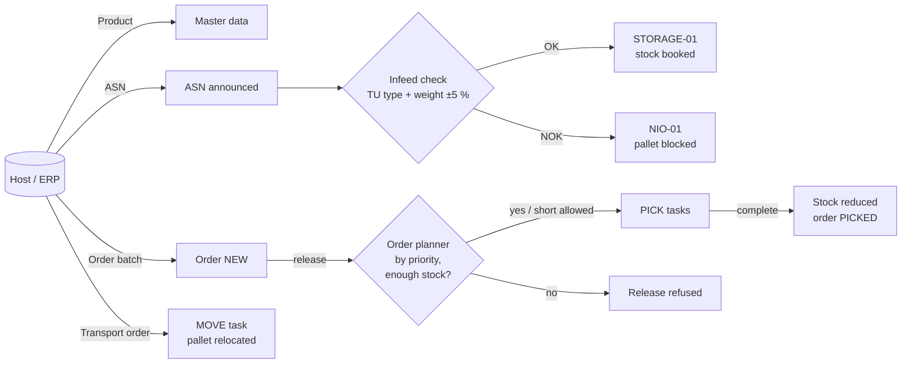
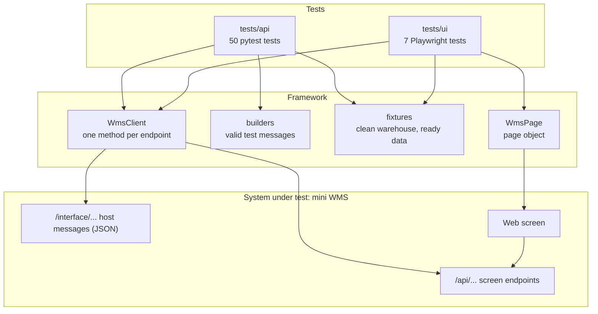
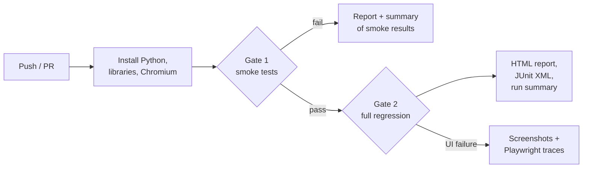

# warehouse-automation-qa

[](https://github.com/Younus98/warehouse-automation-qa/actions/workflows/tests.yml)

A QA automation framework for a **warehouse management system (WMS)**: API tests, UI tests, end-to-end
business flows, a CI pipeline with quality gates, and AI agents that support the QA workflow.

The system under test is a small WMS built for this project. It is modelled on the warehouse automation
systems I have tested: products and advance shipping notices arrive from the customer's ERP, pallets are
checked at the infeed, orders are released by an order planner, and picking tasks move the stock.
The real systems are confidential, so the domain is recreated here with neutral demo data.

| | |
|---|---|
| **Tests** | 57 (50 API, 7 UI) - 11 smoke, 24 negative |
| **Stack** | Python, pytest, Playwright, FastAPI, GitHub Actions |
| **Runs in** | ~5 s locally, ~40 s in CI |
| **AI** | 4 Claude Code agents for test design, code review, bug reports and CI triage - [real example runs](docs/agent-examples/README.md) |

---

## Contents

- [The warehouse flow](#the-warehouse-flow)
- [Architecture](#architecture)
- [Test strategy](#test-strategy)
- [Framework design](#framework-design)
- [CI pipeline](#ci-pipeline)
- [QA agents](#qa-agents)
- [Run it locally](#run-it-locally)
- [Project structure](#project-structure)
- [Next steps](#next-steps)

---

## The warehouse flow



| Term | Meaning |
|---|---|
| **ASN** (Advance Shipping Notice) | The supplier announces a pallet and its contents before it arrives |
| **TU** (Transport Unit) | The physical carrier: `EURO` pallet, `INDU` pallet or `TOTE` |
| **LU** (Load Unit) | Stock of one product on a TU |
| **Infeed check** | On arrival the TU type must match the ASN and the weight must be within ±5 % |
| **NiO** (nicht in Ordnung) | Reject location: the pallet is blocked and its stock does not count |
| **Stock** | `onHand` (available pallets), `allocated` (reserved by open picks), `available` = onHand - allocated |
| **Order planner** | Releases an order: checks stock for every line, then creates one PICK task per pallet used. In a batch, priority 1 orders are released first; equal priorities keep their order (FIFO) |
| **Inventory transaction** | Audit trail of every stock change (`RECEIPT` +, `PICK` -) with its reference |

## Architecture



- **Host interface** (`/interface/...`): the JSON messages an ERP sends - product create, ASN create,
  order batch create/update, transport order create. These are the requests a tester would send from SoapUI.
- **Screen endpoints** (`/api/...`): what the WMS screen uses - infeed scan, stock, orders, release, tasks.
- **Web screen**: Inventory, Receiving, Orders and Tasks tabs.

Data is kept in memory, so every test starts with an empty warehouse (`/api/test/reset`).

## Test strategy

**The pyramid.** Most checks are API tests: fast, stable and close to the business rules.
UI tests prove only what the user sees: messages, buttons and screen updates.

| Layer | Tests | What it proves |
|---|---|---|
| API | 50 | Business rules, validations, status transitions, stock and audit side effects |
| UI | 7 | The main flows work for a user: scan a pallet, release an order, complete a task |

**What is covered, by module**

| Module | Tests | Examples |
|---|---|---|
| Master data | 7 | Duplicate product, field length boundaries |
| Receiving | 17 | ASN validation, infeed OK / NiO, ±5 % weight boundaries, receiving twice |
| Orders | 10 | Batch with one bad order, release, insufficient stock, short allocation, stock reserved by another order |
| Order priority | 5 | Priority 1 wins limited stock over priority 5, in batch create and batch update; FIFO for equal priority |
| Tasks and transport | 8 | Pick reduces stock, task completed twice, moving a pallet with an open task |
| Demo data | 3 | The demo warehouse used to show the screen stays correct |

**Test design techniques**

- **Boundary value analysis** - the ±5 % weight tolerance on a 420 kg pallet is tested at
  398.9 / 399.0 / 420.0 / 441.0 / 441.1 kg; field lengths at 20 and 21 characters.
- **State transitions** - ASN `ANNOUNCED → RECEIVED / NIO`, order `NEW → RELEASED → PICKED`;
  not-allowed transitions (release twice, complete twice, receive twice) are tested too.
- **Equivalence partitioning** - TU types, valid and invalid message fields.
- **Error guessing** - typical warehouse failures: duplicate host messages, stock reserved by another order,
  blocked stock being allocated, moving a pallet that is being picked.

**Side effects, not just responses.** A rejection is not enough: the tests also check that stock, status,
tasks and inventory transactions did **not** change. For example, a refused release asserts that the order is
still `NEW` and no PICK task exists.

**Proving the tests can fail.** Key rules were broken on purpose (e.g. the weight tolerance changed from 5 %
to 10 %) to confirm the tests catch it. A test that never fails proves nothing.

**Not automated (on purpose)** - visual layout, exploratory testing of new features, and performance.
These need a person or a different tool.

## Framework design

| Part | Why it exists |
|---|---|
| [`WmsClient`](framework/wms_client.py) | One method per endpoint. Tests never build URLs, so an endpoint change is fixed in one place. |
| [`builders`](framework/builders.py) | A complete valid message by default; a test changes only the field it is about: `builders.asn(weight=500)`. |
| [Fixtures](tests/conftest.py) | `wms` resets the warehouse before every test; `product` and `stocked_pallet` build ready-made data. Tests are independent and can run in any order. |
| [`WmsPage`](framework/pages/wms_page.py) | Page object: tests say *what* (`scan_pallet(...)`), the page object knows *how*. |
| `data-testid` locators | UI tests don't break when a label is renamed or the page is restyled. |
| API for setup, UI for verification | UI tests create their data through the API in milliseconds and use the browser only for the behaviour under test. |
| Playwright `expect` | Waits automatically for the expected state. There is no `sleep` anywhere. |

Every test follows **Arrange - Act - Assert**. The full rules are in [`CLAUDE.md`](CLAUDE.md).

## CI pipeline

[`.github/workflows/tests.yml`](.github/workflows/tests.yml) runs on every push and pull request to `main`,
and on demand.



- **Two quality gates:** if the 11 smoke tests fail, the run stops early.
- **Results for everyone:** a summary table on the run page (no need to open anything), an HTML report to
  download, and JUnit XML that Jenkins, Azure DevOps or Xray can read.
- **Evidence for failed UI tests:** screenshots and Playwright traces you can replay step by step.

## QA agents

Four [Claude Code](https://docs.claude.com/en/docs/claude-code/overview) agents live in
[`.claude/agents/`](.claude/agents). They all follow the shared rules and warehouse glossary in
[`CLAUDE.md`](CLAUDE.md), so their output matches this framework.

| Agent | Input | Output |
|---|---|---|
| [`test-case-designer`](.claude/agents/test-case-designer.md) | A requirement or user story | Test cases with technique, priority and automation layer, plus open questions |
| [`test-code-reviewer`](.claude/agents/test-code-reviewer.md) | New or changed tests | A verdict and findings; it breaks the app on purpose to check the tests can fail |
| [`bug-report-writer`](.claude/agents/bug-report-writer.md) | A failed test | A ready-to-file bug report with reproduction steps and wider impact |
| [`ci-failure-analyzer`](.claude/agents/ci-failure-analyzer.md) | A red CI run | Each failure classified as product bug, test bug, flaky or environment, plus a release decision |

**Each agent was run on a real task - see the [example runs](docs/agent-examples/README.md).**
In one run the CI analyzer found that the smoke gate was hiding a critical product bug behind a test bug,
and that the pipeline lost its report when the smoke gate failed. The pipeline was fixed as a result.

**How a feature is built with the agents** - order priority went through the full loop:
`test-case-designer` turned the requirement into 18 test cases and found that priority was stored but never used;
the open questions (tie-breaking, short allocation) were answered as product decisions and written into `CLAUDE.md`;
the tests were written first and failed, then the rule was implemented;
`test-code-reviewer` found two untested parts of the rule (batch update, FIFO), and two tests were added before merge.

## Run it locally

Requires **Python 3.10+**.

```bash
git clone https://github.com/Younus98/warehouse-automation-qa.git
cd warehouse-automation-qa
python -m venv .venv
.venv\Scripts\activate            # Windows   (macOS/Linux: source .venv/bin/activate)
python -m pip install -r requirements.txt
python -m playwright install chromium

python -m pytest                  # all 57 tests
python -m pytest -m smoke         # quick check
python -m pytest tests/api        # API tests only
```

**Start the WMS** and open the screen at <http://localhost:8000> and the API docs at <http://localhost:8000/docs>:

```bash
uvicorn wms_app.main:app --reload
```

Click **Load demo data** (top right of the screen) to fill the warehouse with pallets, orders and a pick task.
Example host messages to send are in [`samples/`](samples).

**Watch the UI tests click through the browser:** `python -m pytest tests/ui --headed --slowmo 700`

**VS Code:** the project includes a [`.vscode`](.vscode) setup. Tests appear in the Testing panel,
and *Run and Debug* has **Start Mini WMS** and **Debug current test file**.

**Behind a company proxy?** If `playwright install` fails with a certificate error, use the installed Microsoft Edge
instead of downloading a browser: `python -m pytest --browser-channel msedge`. To make it permanent on your machine,
put `PYTEST_ADDOPTS=--browser-channel msedge` in a `.env` file (ignored by Git).

## Project structure

```
wms_app/
  main.py                 the mini WMS (system under test)
  static/index.html       the WMS screen
framework/
  wms_client.py           API client - one method per endpoint
  builders.py             test data builders
  pages/wms_page.py       page object
tests/
  conftest.py             shared fixtures
  api/                    50 API tests
  ui/                     7 Playwright tests + UI fixtures
samples/                  example host messages
tools/junit_summary.py    CI run summary
.github/workflows/        CI pipeline
.claude/agents/           QA agents
docs/agent-examples/      real agent outputs
CLAUDE.md                 domain glossary and test rules
```

## Next steps

Found by the `test-case-designer` agent and planned next:

- **Max pallet weight (1,000 kg)** - reject heavy pallets at the ASN and the infeed
  ([31 test cases designed](docs/agent-examples/01-test-case-designer.md)).
- **Blocked pallets can be moved out of NiO** - a transport order does not check the pallet status today.

Done: **Order priority in the order planner** - priority 1 is released before priority 5 (5 tests).
